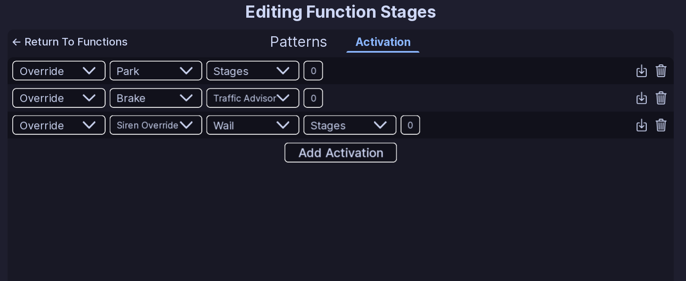
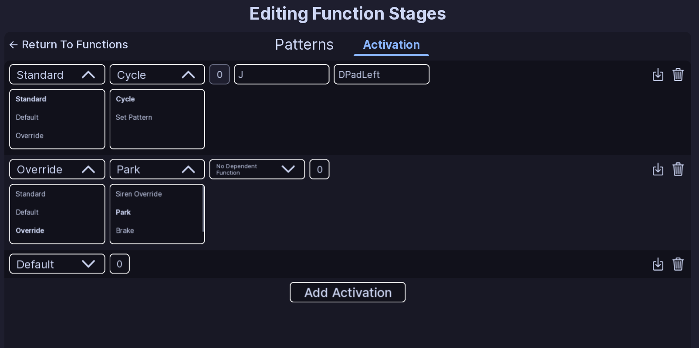

# Activations

!!! tip ""
    Prefer videos? Check out our [YouTube playlist](https://youtube.com/playlist?list=PL7OqW0xeBKZTbk4QMl-6v3V_x11pZBV0W&si=e_bKE-MbL-B76wQk) for video guides on how to use the plugin.

??? warning "Documentation is a Work in Progress"
    This documentation is a work in progress and may be missing information or contain errors.
    If you need help please contact us on our [Discord server](https://redon.tech/discord)!

    If you know about this topic and want to help us, please consider contributing to this page on [GitHub](https://github.com/Redon-Tech/Emergency-Vehicle-Creator).

Activations decide when a function is used and which pattern it selects.

A function can have more than one activation.

## Standard

A **Standard** activation uses one or more keybinds.

It has two modes:

- **Cycle** — moves through the patterns in the function.
- **Set Pattern** — selects a specific pattern.

For **Set Pattern**, enter the pattern number you want to use.

The default Standard activation uses **J** and **DPadLeft**.

## Default

A **Default** activation chooses the pattern that is used by default.

Select the pattern number you want to use.

## Override

An **Override** activation changes a function based on another vehicle state.

The available options are:

- **Siren Override**
- **Park**
- **Brake**
- **Reverse**

For **Siren Override**, choose the siren that should trigger the override.

You can also choose another function and pattern for the override to use.

## AG-Event

AG-Event activations are available for AG-Chassis and MG-Chassis vehicles.

Available events:

- **Stages**
- **Traffic Advisor**
- **Scene**
- **Ally Left**
- **Ally Right**
- **Rear Scene**

These do not use a keybind or pattern number.

## Editing an activation

1. Open a function.
2. Open the **Activation** tab.
3. Choose the activation you want to edit.
4. Change its type or settings.
5. Use the delete control to remove an activation.

Changes are saved as part of the vehicle configuration.

!!! note
    Pattern numbers start at 0 in the configuration. The first pattern is 0.

## :material-check-circle: All Done!

You can now use activations to control when each function changes its pattern.

Here are some recommended next steps to help you get started:

1. **[Function Setup](index.md)**: Learn how functions organize patterns and activations.
2. [Flashers](../../../patterns/flashers.md): Learn how to create a basic light pattern.
3. [Siren Setup](../../siren-setup.md): Learn how to set up and configure sirens.

---

If you encounter any issues or have questions, feel free to [contact us on Discord](https://redon.tech/discord).
