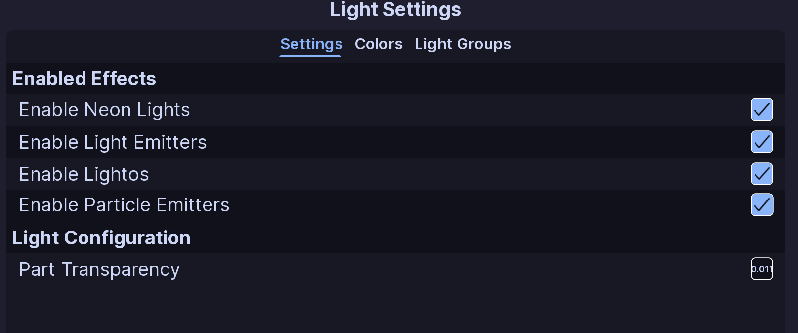
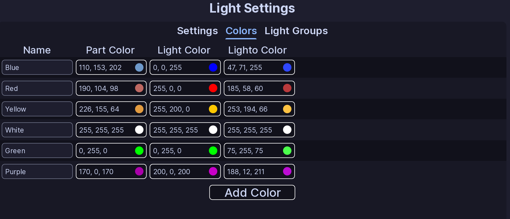

# Light Settings

!!! tip ""
    Prefer videos? Check out our [YouTube playlist](https://youtube.com/playlist?list=PL7OqW0xeBKZTbk4QMl-6v3V_x11pZBV0W&si=e_bKE-MbL-B76wQk) for video guides on how to use the plugin.

??? warning "Documentation is a Work in Progress"
    This documentation is a work in progress and may be missing information or contain errors.
    If you need help please contact us on our [Discord server](https://redon.tech/discord)!

    If you know about this topic and want to help us, please consider contributing to this page on [GitHub](https://github.com/Redon-Tech/Emergency-Vehicle-Creator).

Use **Light Settings** to control how the lights on your vehicle behave.

The page has three sections:

- **Settings**
- **Colors**
- **Light Groups**

## Settings

### Enabled Effects

These options control which light types EVC changes:

- **Enable Neon Lights**
- **Enable Light Emitters**
- **Enable Lightos**
- **Enable Particle Emitters**

Particle emitters are disabled by default.

### Part Transparency

**Part Transparency** controls the transparency used for light parts.

Enter a value and leave the field to save it.

## Colors

Each color has:

- **Name**
- **Part Color**
- **Light Color**
- **Lighto Color**

EVC starts with these six colors:

- Blue
- Red
- Yellow
- White
- Green
- Purple

These six built-in colors cannot be renamed or deleted.

Click **Add Color** to create your own color. Custom colors can be renamed, edited, and deleted.

If you delete a custom color, EVC also removes it from any flashers, faders, or rotators that were using it.

## Light Groups

Light groups let you control several lights as one group.

Click **Add Light Group** to create one.

You can:

- rename a group
- expand or collapse it
- add or remove lights
- delete the group

Hold **Left Shift** while selecting lights to select a range.

A light can only be added once to the same group.

!!! note
    The lights shown here come from the equipment on your vehicle. If a light is missing, check the equipment setup and its Light Prefix.

## :material-check-circle: All Done!

Your colors, effects, and light groups are ready to use in ELS patterns.

Here are some recommended next steps to help you get started:

1. **[Flashers](../../patterns/flashers.md)**: Learn how to create a flashing pattern.
2. [Faders](../../patterns/faders.md): Learn how to create a fading pattern.
3. [Rotators](../../patterns/rotators.md): Learn how to create a rotating pattern.

---

If you encounter any issues or have questions, feel free to [contact us on Discord](https://redon.tech/discord).
