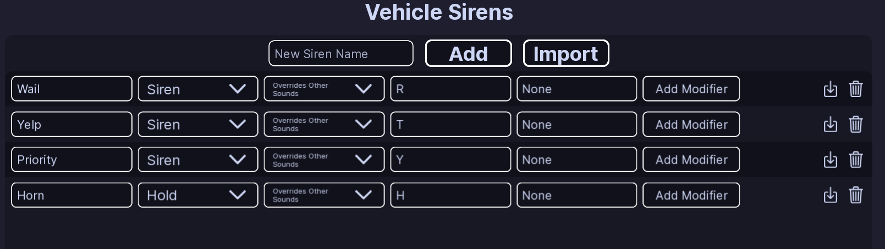
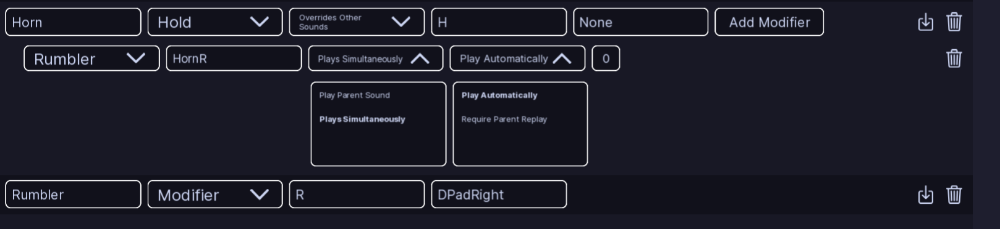

# Siren Setup

!!! tip ""
    Prefer videos? Check out our [YouTube playlist](https://youtube.com/playlist?list=PL7OqW0xeBKZTbk4QMl-6v3V_x11pZBV0W&si=e_bKE-MbL-B76wQk) for video guides on how to use the plugin.

??? warning "Documentation is a Work in Progress"
    This documentation is a work in progress and may be missing information or contain errors.
    If you need help please contact us on our [Discord server](https://redon.tech/discord)!

    If you know about this topic and want to help us, please consider contributing to this page on [GitHub](https://github.com/Redon-Tech/Emergency-Vehicle-Creator).

The **Sirens** page lets you set up the sounds used by your vehicle.

## Add a siren

1. Enter a name in **New Siren Name**.
2. Click **Add**.

If you leave the name empty, EVC uses **Wail**. If the name is already being used, EVC gives the new siren a unique name.

Each siren has a type:

- **Siren** — a normal siren that can be turned on and off.
- **Hold** — plays while its keybind is held.
- **Modifier** — changes how another siren behaves.

## Siren behavior

Normal and Hold sirens have two options:

- **Overrides Other Sounds** — the siren takes control over other sounds.
- **Plays Simultaneously** — the siren can play at the same time as other sounds.

You can give a siren one or more keybinds.

### Default sirens

| Siren | Type | Key |
| --- | --- | --- |
| Wail | Siren | R |
| Yelp | Siren | T |
| Priority | Siren | Y |
| Horn | Hold | H |

The default setup also has controller keybind slots. An **Unknown** key means no controller key is assigned.

## Siren modifiers

You can add a modifier to a Siren or Hold siren with **Add Modifier**.

A modifier lets you use another sound and choose what happens to the original siren.

Its settings include:

- **Siren** — which modifier sound to use.
- **Modified Siren Name** — the sound that will play.
- **Play Parent Sound / Plays Simultaneously** — whether the original siren keeps playing.
- **Play Automatically / Require Parent Replay** — when the modified sound starts.
- **Delay** — how long to wait before it starts.

## Delete a siren or modifier

Use the delete control next to the item you want to remove.

EVC asks you to confirm before deleting it.

!!! note
    If you rename a siren, check any settings that use that siren's name.

## :material-check-circle: All Done!

Your vehicle now has its sirens, keybinds, and modifiers configured.

Here are some recommended next steps to help you get started:

1. **[Function Setup](functions/index.md)**: Learn how to set up functions to create ELS.
2. [Light Settings](light-settings.md): Learn how to configure the lights used by your vehicle.
3. [Flashers](../../patterns/flashers.md): Learn how to create a basic light pattern.

---

If you encounter any issues or have questions, feel free to [contact us on Discord](https://redon.tech/discord).
