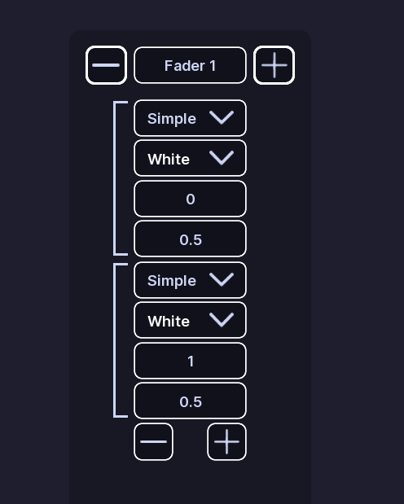
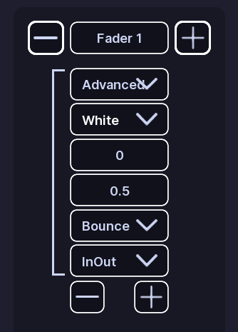

# Faders

!!! tip ""
    Prefer videos? Check out our [YouTube playlist](https://youtube.com/playlist?list=PL7OqW0xeBKZTbk4QMl-6v3V_x11pZBV0W&si=e_bKE-MbL-B76wQk) for video guides on how to use the plugin.

??? warning "Documentation is a Work in Progress"
    This documentation is a work in progress and may be missing information or contain errors.
    If you need help please contact us on our [Discord server](https://redon.tech/discord)!

    If you know about this topic and want to help us, please consider contributing to this page on [GitHub](https://github.com/Redon-Tech/Emergency-Vehicle-Creator).

Faders smoothly change a light over time.

A fader section controls one light and contains a list of steps.

## Create a fader

1. Open a pattern.
2. Open **Faders**.
3. Click **Add Section**.
4. Enter the light name you want to control.

You can add multiple steps to a section.

## Step types

### Simple

A Simple step changes the light to a target transparency over a set amount of time.

It uses:

- **Time**
- **Goal**
- **Color**

### Advanced

Advanced steps have the same settings as Simple steps, plus:

- **Easing Style**
- **Easing Direction**

These control how the change happens.

### Wait

A Wait step does not change the light.

It waits for the amount of time entered in **Time**, then moves to the next step.

## Preview

Use **Play** to start the preview.

Use **Pause** to stop it.

Use **Refresh** to reset it.

The preview loops through the steps.

## Edit steps

Use the add control to add a step.

Use the delete control to remove one.

When you change a step type, settings that do not apply to the new type are removed.

!!! note
    Fader colors come from **Light Settings**.

## :material-check-circle: All Done!

You have created a fading pattern for your vehicle.

Here are some recommended next steps to help you get started:

1. **[Flashers](flashers.md)**: Learn how to create a flashing pattern.
2. [Rotators](rotators.md): Learn how to create a rotating pattern.
3. [Light Settings](../els-setup/light-settings.md): Learn how to configure colors and light groups.

---

If you encounter any issues or have questions, feel free to [contact us on Discord](https://redon.tech/discord).
