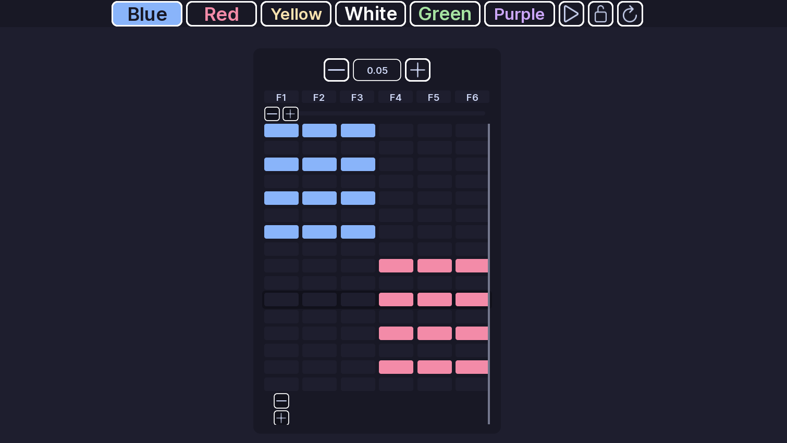

# Flashers

!!! tip ""
    Prefer videos? Check out our [YouTube playlist](https://youtube.com/playlist?list=PL7OqW0xeBKZTbk4QMl-6v3V_x11pZBV0W&si=e_bKE-MbL-B76wQk) for video guides on how to use the plugin.

??? warning "Documentation is a Work in Progress"
    This documentation is a work in progress and may be missing information or contain errors.
    If you need help please contact us on our [Discord server](https://redon.tech/discord)!

    If you know about this topic and want to help us, please consider contributing to this page on [GitHub](https://github.com/Redon-Tech/Emergency-Vehicle-Creator).

Flashers turn lights on and off in steps.

A flasher section is a grid:

- each **column** is a light
- each **row** is a step

## Create a flasher

1. Open a pattern.
2. Open **Flashers**.
3. Click **Add Section**.
4. Add the lights you want to control.

Enter the exact light name used by the vehicle.

## Set the lights

Choose a color for a cell to turn the light on with that color.

Set a cell to **None** to turn the light off.

You can also draw across the grid:

- **Left click** adds the selected color.
- **Right click** clears the cell.
- When drawing is locked, you can limit drawing to the selected column.

## Wait time

Each row has a **Wait Time**.

It controls how long that row stays active before moving to the next row.

A lower value makes the pattern move faster.

A value of 0 is also supported. The pattern then advances one step per frame.

## Preview

Use **Play** to preview the pattern.

Use **Refresh** to reset the preview.

## Multiple sections

Click **Add Section** to add another flasher section.

Use the delete control to remove a section. EVC asks for confirmation first.

!!! note
    The colors available here come from **Light Settings**.

## :material-check-circle: All Done!

You have created a flashing pattern for your vehicle.

Here are some recommended next steps to help you get started:

1. **[Faders](faders.md)**: Learn how to create a fading pattern.
2. [Rotators](rotators.md): Learn how to create a rotating pattern.
3. [Light Settings](../els-setup/light-settings.md): Learn how to configure colors and light groups.

---

If you encounter any issues or have questions, feel free to [contact us on Discord](https://redon.tech/discord).
