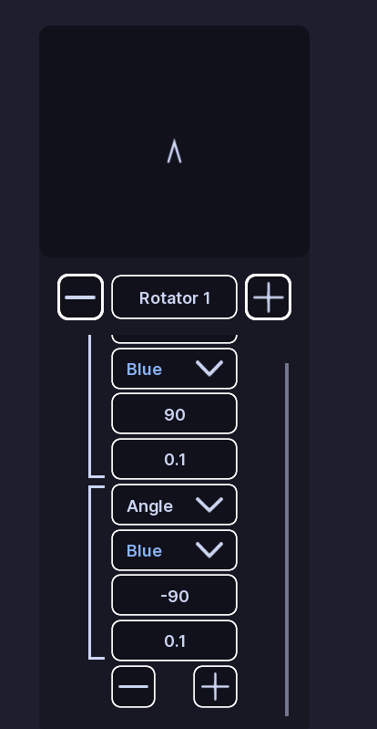
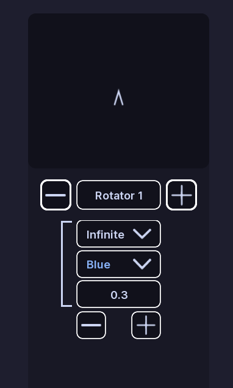

# Rotators

!!! tip ""
    Prefer videos? Check out our [YouTube playlist](https://youtube.com/playlist?list=PL7OqW0xeBKZTbk4QMl-6v3V_x11pZBV0W&si=e_bKE-MbL-B76wQk) for video guides on how to use the plugin.

??? warning "Documentation is a Work in Progress"
    This documentation is a work in progress and may be missing information or contain errors.
    If you need help please contact us on our [Discord server](https://redon.tech/discord)!

    If you know about this topic and want to help us, please consider contributing to this page on [GitHub](https://github.com/Redon-Tech/Emergency-Vehicle-Creator).

Rotators move a light through different angles.

A rotator section controls one light and contains a list of steps.

## Create a rotator

1. Open a pattern.
2. Open **Rotators**.
3. Click **Add Section**.
4. Enter the light name you want to control.

## Step types

### Angle

An **Angle** step moves the light by the amount entered in **Angle**.

It also uses:

- **Color**
- **Velocity**

### Infinite

An **Infinite** step keeps the light rotating until the next step.

It uses:

- **Color**
- **Velocity**

### Wait

A **Wait** step pauses the sequence for the entered **Wait Time**.

## Preview

Use **Play** to preview the rotation.

Use **Pause** to stop it.

Use **Refresh** to reset it.

The sequence loops while the preview is running.

## Edit steps

Use the add control to add a step.

Use the delete control to remove one.

EVC asks for confirmation before deleting a step.

!!! note
    Rotator colors come from **Light Settings**.

## :material-check-circle: All Done!

You have created a rotating pattern for your vehicle.

Here are some recommended next steps to help you get started:

1. **[Flashers](flashers.md)**: Learn how to create a flashing pattern.
2. [Faders](faders.md): Learn how to create a fading pattern.
3. [Light Settings](../els-setup/light-settings.md): Learn how to configure colors and light groups.

---

If you encounter any issues or have questions, feel free to [contact us on Discord](https://redon.tech/discord).
